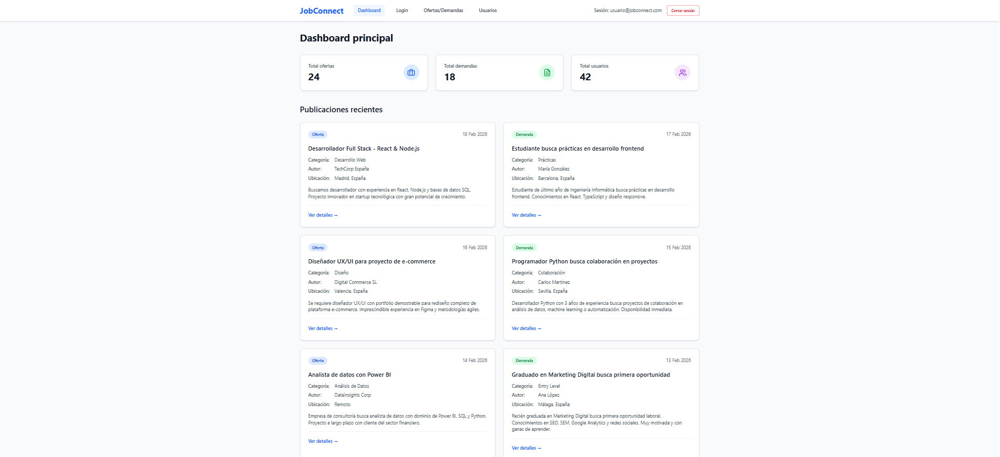

# JobConnect · versión individual

Plataforma web de ofertas y demandas de empleo hecha con **JavaScript puro**, sin frameworks y sin backend.
Los datos se guardan en el navegador con **IndexedDB** y la sesión con **localStorage**.

🔗 **Demo:** https://cmigueldev99.github.io/jobconnect-producto2-carles/

Usuario de prueba: `laura@jobconnect.com` / `1234` (datos ficticios de demostración).



## Qué hace

- **Login** con validación contra los usuarios guardados y sesión persistente.
- **Gestión de usuarios:** alta, listado y baja, con validaciones (campos obligatorios y email duplicado).
- **Gestión de ofertas y demandas:** alta, listado y baja.
- **Dashboard:** contadores, tarjetas de publicaciones que se pueden reordenar con **drag & drop** y un gráfico dibujado con la **Canvas API**.

## Tecnologías

HTML5 · CSS3 · Bootstrap 5 · JavaScript (ES Modules) · IndexedDB · localStorage · Drag & Drop API · Canvas API

## Mi papel

Es la parte individual del proyecto JobConnect del ciclo de DAW (UOC). Todo el código de este repositorio es mío, del Producto 1 al Producto 2.

Lo que más trabajé:
- **Capa de persistencia** (`assets/js/almacenamiento.js`): paso de datos en memoria a IndexedDB, con datos iniciales.
- **Lógica de cada pantalla** en módulos ES separados (`login.js`, `usuarios.js`, `ofertas-demandas.js`, `dashboard.js`).
- **Dashboard interactivo** con drag & drop y gráfico en Canvas.

## Qué aprendí

- Organizar el JavaScript en módulos sin depender de ningún framework.
- Trabajar con una API asíncrona del navegador (IndexedDB) y separar el acceso a datos de la interfaz.
- Validar formularios y dar mensajes de error claros al usuario.

## Cómo ejecutarlo en local

1. Clona el repositorio.
2. Abre la carpeta con un servidor local. Por ejemplo, la extensión **Live Server** de VS Code: clic derecho en `index.html` → *Open with Live Server*.
   Hace falta un servidor porque los módulos ES no se cargan abriendo el archivo directamente.

## Estructura

```
├── index.html               # Dashboard
├── login.html
├── ofertas-demandas.html
├── usuarios.html
├── assets/
│   ├── css/styles.css
│   └── js/                  # Un módulo por pantalla + almacenamiento.js
└── docs/mockups/            # Mockups de las pantallas
```

---
Proyecto académico del CFGS de Desarrollo de Aplicaciones Web (Jesuïtes Educació – UOC).
